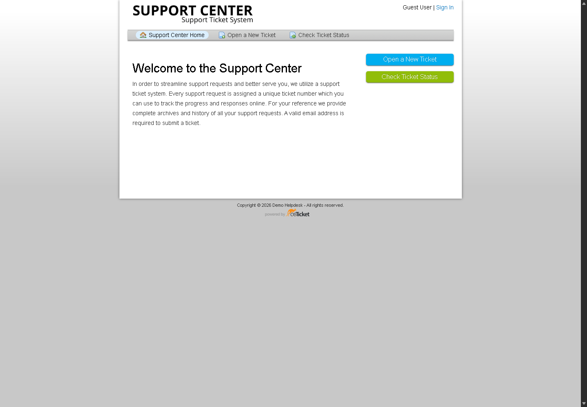
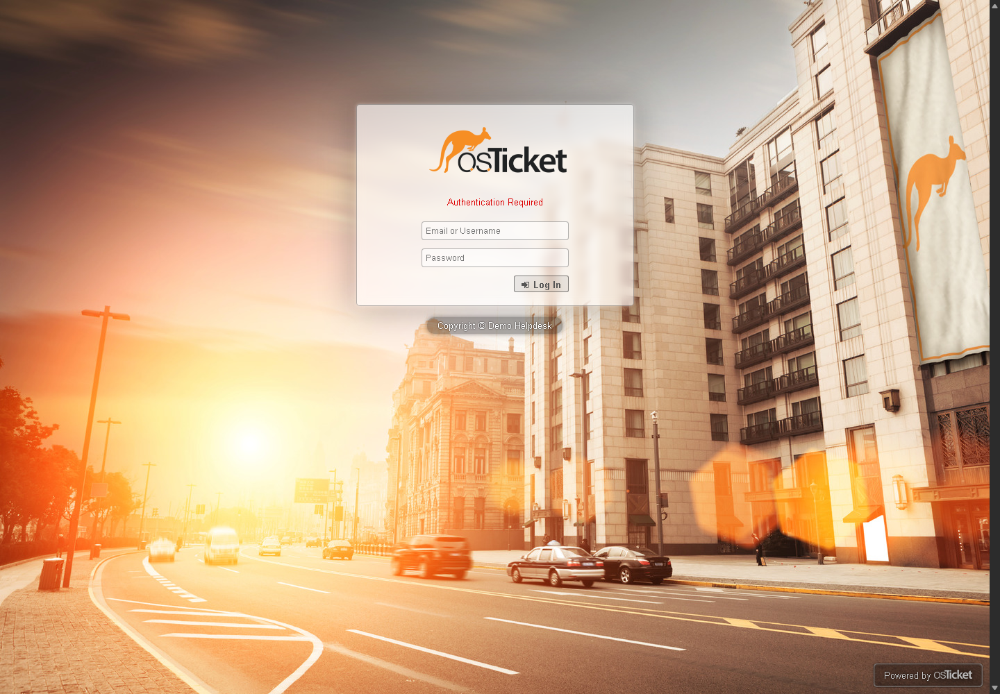
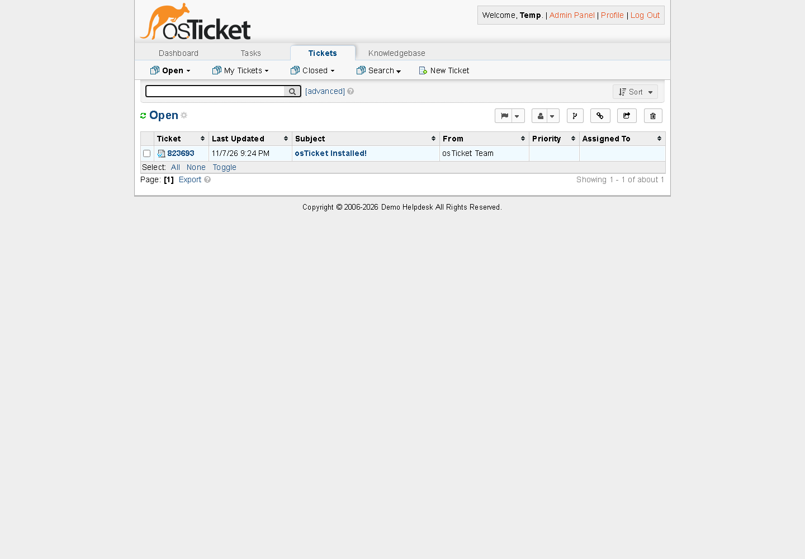
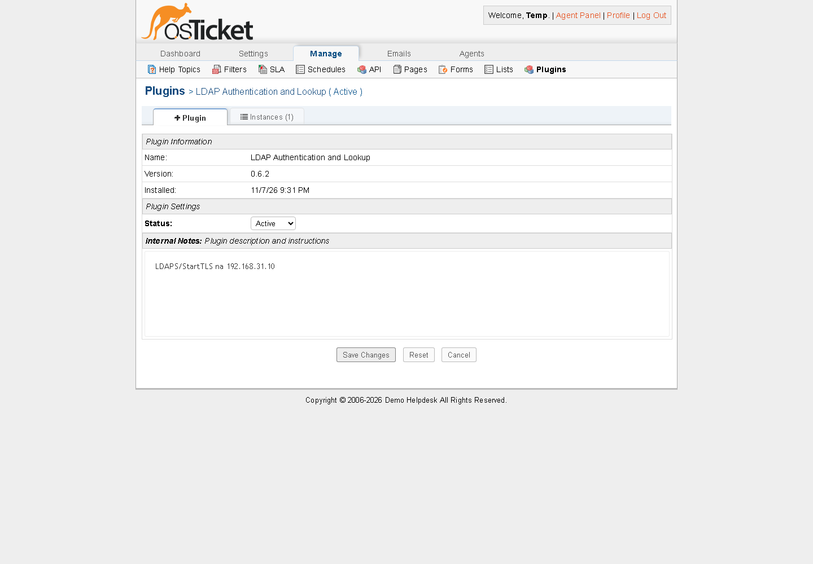
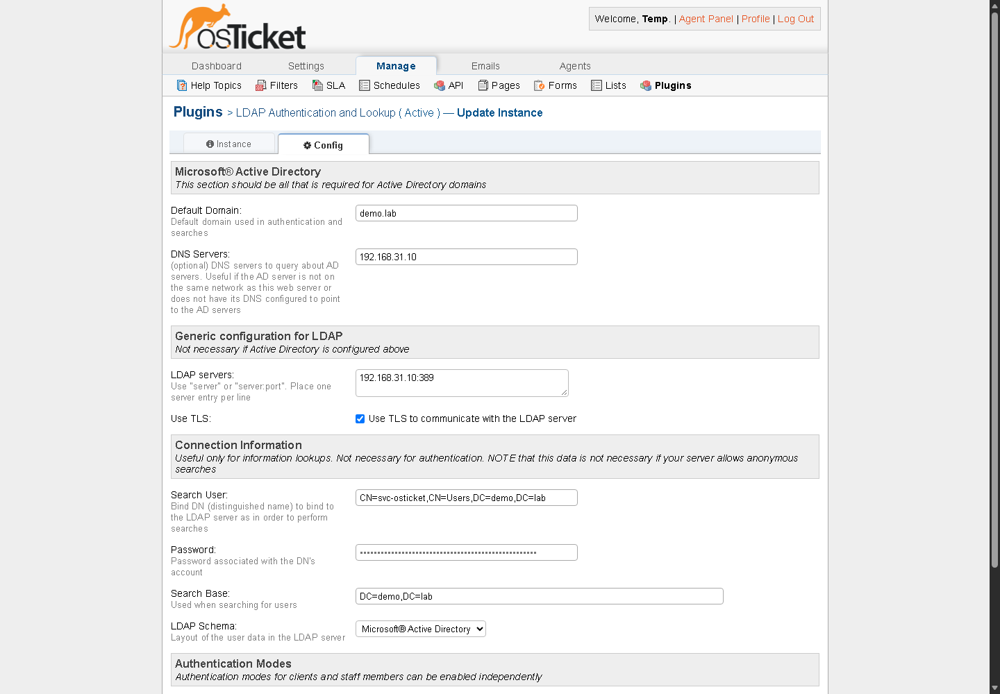
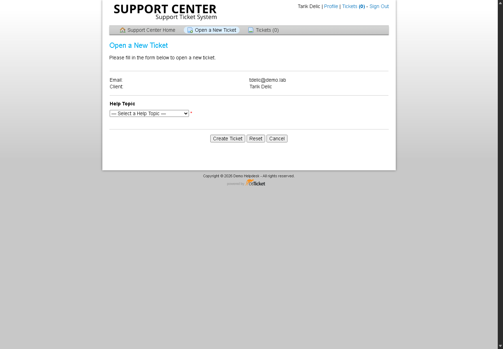

# Hybrid Linux + Windows Enterprise Ticketing System

Ubuntu Server joined to a **Windows Server 2025 Active Directory** domain, running **osTicket 1.18.4** with **LDAP / Active Directory authentication** — one domain account for both the Windows world and the helpdesk.

The full lab (network plan, every command, pitfalls and test results) is documented in **[docs/ubuntu-ad-osticket-skripta.pdf](docs/ubuntu-ad-osticket-skripta.pdf)** (Serbian, 20 pages) with the HTML source next to it.

---

## What this project demonstrates

- **Windows Server 2025** as a domain controller — AD DS, DNS, forwarders, OUs, users and security groups for `demo.lab`
- **Ubuntu Server** joined to the domain with `realmd` / `sssd` (domain logins work on Linux)
- **LAMP stack** — Apache, MariaDB, PHP with the LDAP extension
- **osTicket** installed, hardened (`setup/` removed, config locked) and connected to AD through the official **LDAP Authentication and Lookup** plugin
- **StartTLS** LDAP connection with a read-only service account
- **Verified end-to-end**: agents and end users sign in to osTicket with their **domain password**

## Architecture

| Role | Machine | Address |
|---|---|---|
| Gateway / router | home network | `192.168.31.1` |
| Domain controller + DNS | Windows Server 2025 (`demo.lab`) | `192.168.31.10` |
| Application server | Ubuntu Server (Apache, MariaDB, PHP, osTicket) | `192.168.31.20` |

Both virtual machines run in **bridged** mode, so they are peers on the same physical network.

## How authentication works

```
Browser ──► osTicket (Ubuntu 192.168.31.20)
                │
                │  LDAP over StartTLS (389)
                ▼
        Active Directory (Windows 192.168.31.10)
                ▲
                │  read-only bind: CN=svc-osticket,CN=Users,DC=demo,DC=lab
```

- The plugin searches the directory under the service-account bind.
- Agents and clients are authenticated with a **simple bind using the credentials the user typed**.
- Usernames resolve through `sAMAccountName`; `user@demo.lab` logins resolve through `mail`.
- Client logins automatically provision a matching osTicket user (`ldap.client.*` backend).

## Test results

| Test | Result |
|---|---|
| StartTLS bind as the service account | **OK** — `u:DEMO\svc-osticket` |
| Agent login with username + domain password | **OK** — staff control panel |
| Agent login with `user@demo.lab` | **OK** |
| Agent login with a wrong password | **Denied** |
| Client login with `user@demo.lab` | **OK** — user auto-created |
| Proof that AD performs the authentication | `badPwdCount` incremented, `lastLogon` refreshed |
| Members of `osticket-agents` visible over LDAP | **OK** |

## Screenshots

| | |
|---|---|
|  |  |
| Client portal | Agent login |
|  |  |
| Admin panel | Installed LDAP plugin |
|  |  |
| LDAP configuration (StartTLS, bind DN, base DN) | Agent signed in with the domain password |
|  | |
| Client signed in with the domain password | |

## Repository layout

```
docs/
  ubuntu-ad-osticket-skripta.html   full project documentation (source)
  ubuntu-ad-osticket-skripta.pdf    full project documentation (20 pages)
  screenshots/                      7 screenshots used in the documentation
stage/
  vm.py                             SSH/SFTP helper for the Ubuntu VM
  inspect*.sh                       database / configuration inspection
  ldap_check.sh, ldap_user_test.sh  LDAP bind and group checks
  ad_setup.py, ad_fix_users.py      AD group, members and attribute preparation
  ad_rpc_pw.sh                      password reset over SAMR (rpcclient)
  ost_*.php                         osTicket ORM helpers (staff, backend, password)
  ost_*_login*.py                   HTTP login tests (agent and client)
  cdp_*_shot.py                     authenticated screenshots via Edge DevTools
```

## Reproducing the lab

1. Install Windows Server 2025, promote it to a DC for `demo.lab`, set the static IP and DNS forwarder.
2. Install Ubuntu Server, configure netplan, verify DNS, then join the domain:
   `realm join --user=Administrator demo.lab`
3. Install the LAMP stack and osTicket 1.18.4 in `/var/www/html/osticket`, run the web installer, then delete `setup/`.
4. Create a read-only AD service account and the `osticket-agents` group.
5. Install **LDAP Authentication and Lookup** in osTicket and configure the domain, servers, StartTLS, bind DN and search base.
6. Set each agent's *Authentication backend* to the AD instance.
7. Run the tests from the table above.

All commands, values and troubleshooting notes are in the PDF.

Scripts read credentials from environment variables, for example:

```bash
export ADMIN_PW='...'
export LDAP_BIND_PW='...'
export OST_DB_PW='...'
export VM_PASS='...'
```

## Known limitations

- The stock LDAP plugin **does not map AD groups to osTicket roles** — the role is still assigned inside osTicket. The `osticket-agents` group is used for lookup / "Add agent from directory"; automatic role mapping would require a custom plugin.
- The lab uses StartTLS with `LDAPTLS_REQCERT=never` because the DC certificate is self-signed. Production should use LDAPS with a trusted certificate.
- osTicket 1.18.4 officially supports PHP 8.2–8.4; this lab runs PHP 8.5.4 (works, but 8.4 is the safer choice).
- The email pipeline (SMTP/IMAP) is not configured — tickets are followed through the web portal.
- `chrony` falls back to public NTP; the DC is not used as the time source (dispersion).

## License

[MIT](LICENSE) — educational / laboratory project. Do not deploy the lab credentials or the self-signed TLS setup to production.
